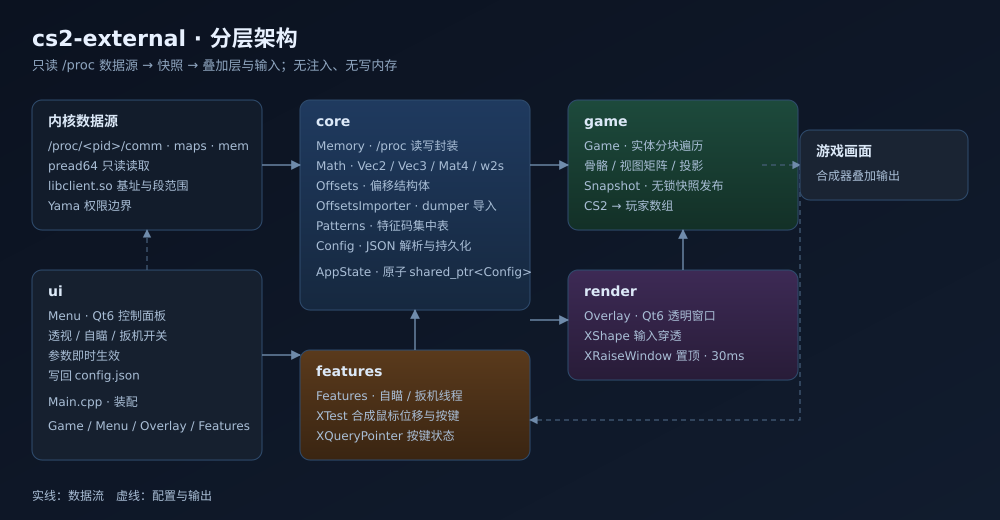
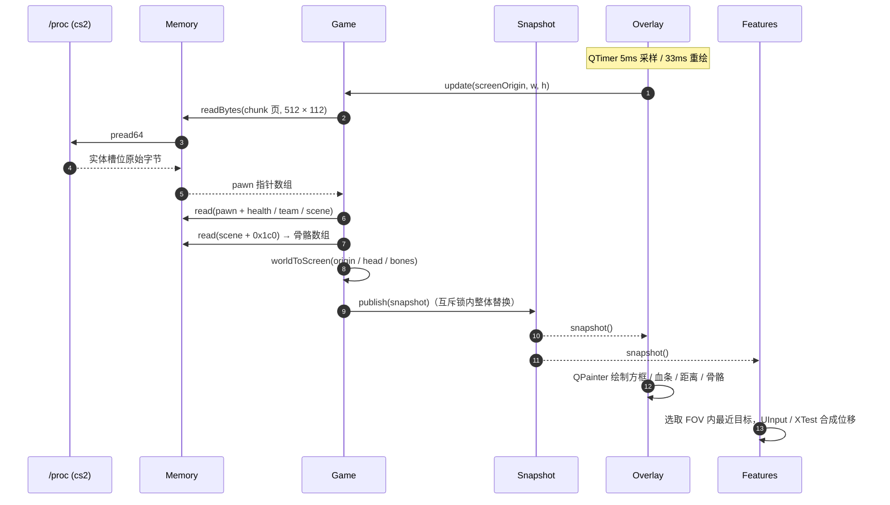
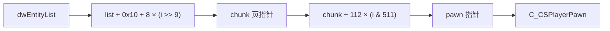
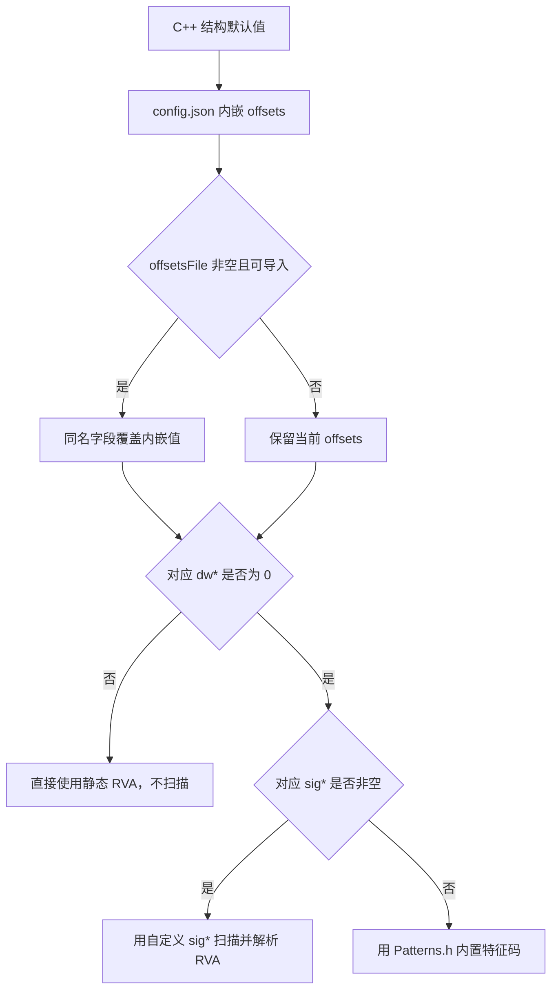

<div align="center">

# cs2-external

**Linux 原生 · CS2 外部辅助 · ESP / 自瞄 / 扳机 / 直接内存**

一份可审计、可维护的工程化实现：不注入、不附加调试器。采集链路通过 `/proc/<pid>/mem` 读取游戏状态，输入优先使用 UInput、失败时回退 XTest；「内存」页的加速 / 子弹追踪内存锁 / 飞天 / 身体旋转 / 真无后坐力 / 弹着点控制六组功能，在显式开启且具备写权限时直接写进程内存，默认全关。

**官网**：[cs2.xn--rhyr4ib67a.top](https://cs2.xn--rhyr4ib67a.top/) · 源码在 [`web/`](web/)

[](https://www.kernel.org/)
[](https://isocpp.org/)
[](https://www.qt.io/)
[](https://cmake.org/)
[](LICENSE)
[](https://github.com/PFLcoolme/cs2-external/releases/latest)
[](https://cs2.xn--rhyr4ib67a.top/)
[](https://www.x.org/)
[](https://github.com/PFLcoolme/cs2-external/stargazers)
[](https://github.com/PFLcoolme/cs2-external/commits/main)

</div>

> [!IMPORTANT]
> **开源许可**：本仓库公开代码、文档及已发布历史版本采用 [GPL-3.0-only](LICENSE)。复制、修改或再分发时须遵守 GNU GPL v3；该授权不撤回已发布版本既有的开源权利。

---

## 目录

| 章节 | 内容 |
|---|---|
| [1. 项目概览](#1-项目概览) | 定位、能力边界、非目标 |
| [2. 架构总览](#2-架构总览) | 分层图、模块职责 |
| [3. 数据流](#3-数据流) | 时序、实体分块模型 |
| [4. 技术栈](#4-技术栈) | 语言、框架、系统库 |
| [5. 环境要求](#5-环境要求) | 编译器、依赖、权限 |
| [6. 快速开始](#6-快速开始) | 构建、运行、验证 |
| [7. 配置说明](#7-配置说明) | 字段表、优先级、热更新 |
| [8. 偏移维护](#8-偏移维护) | 生成器、实测样例、骨骼布局 |
| [9. 关键实现](#9-关键实现) | 投影、叠加层、输入合成 |
| [10. 性能基线](#10-性能基线) | 实测数据与瓶颈 |
| [11. 故障排查](#11-故障排查) | 现象 → 根因 → 处置 |
| [12. 项目结构](#12-项目结构) | 目录树 |
| [13. 开发流程](#13-开发流程) | 规划文档、阶段日志、提交规范 |
| [14. 合规边界](#14-合规边界) | 读写边界、使用限制 |
| [15. 路线图](#15-路线图) | 后续计划 |
| [16. 许可证](#16-许可证) | 授权状态 |

---

## 1. 项目概览

`cs2-external` 是一个运行在 Linux 桌面上的 CS2 **外部**辅助程序。它通过 `/proc/<pid>/mem` 获取游戏状态，用 Qt6 无边框透明窗口叠加信息；输入功能通过 UInput（优先）或 XTest 合成鼠标事件，直接内存功能则在显式开启且具备写权限时修改对应字段。

**核心能力**

| 能力 | 说明 | 状态 |
|---|---|---|
| 方框透视 | 按玩家包围盒绘制矩形，颜色区分敌我 | ✅ 可用 |
| 血条 / 数值 | 竖向血条、血量读数、护甲读数 | ✅ 可用 |
| 距离 | 目标脚下显示米数（units ÷ 39.37） | ✅ 可用 |
| 骨骼连线 | 头 → 颈 → 胸 → 骨盆，白色连线 | ✅ 可用（版本相关） |
| 伤害浮字 | 掉血时浮出损失数值，时长与颜色可调 | ✅ 可用 |
| 残影轨迹 | 脚底屏幕坐标的历史折线，保留时长可调 | ✅ 可用 |
| 2D 雷达 | 位置可选（底部居中 / 四角），可随视角旋转，带三等分距离圈与米数刻度 | ✅ 可用 |
| 屏外指示 | 视野外敌人在屏幕边缘显示方位箭头与距离 | ✅ 可用 |
| 敌人列表 | 位置可选，按距离排序，最多 10 行，显示血量 | ✅ 可用 |
| 高度差 | 目标在楼上/楼下用 ▲▼ 标出，附米数 | ✅ 可用 |
| 自瞄 | FOV 内目标平滑位移到头部；触发键可配（默认开镜 + 开火同时按住），支持锁定单一目标 | ✅ 可用 |
| 后坐力抵消 | 按 `m_aimPunchAngle` 反向补偿，可限制仅开火时生效 | ✅ 可用 |
| 子弹追踪 | 按住触发键把准星贴到最近目标头部 | ✅ 可用 |
| 静默锁头 | 贴头 → 点击 → 归位，在 `holdMs` 内完成 | ✅ 可用 |
| 扳机 | 准星指向敌人时合成左键点击 | ✅ 可用 |
| 可见性双色 | 基于 `m_bSpotted` 降低不可见目标透明度 | ✅ 可用（版本相关） |
| 控制面板 | 深色双栏分类导航 + 卡片行 + 就地展开参数，400ms 防抖自动保存 | ✅ 可用 |
| 面板热键 | **F8** 显隐面板，键位可在日志页录制修改 | ✅ 可用 |
| Panic 键 | **F9** 一键收掉叠加层并停止全部输入合成，键位可改 | ✅ 可用 |
| 命中统计 | 状态行显示累计命中次数与伤害，与「伤害浮字」开关无关 | ✅ 可用 |
| 启动自检 | 日志页逐项列出模块基址、9 个关键偏移与 2 个运行时指针，缺失项标红 | ✅ 可用 |
| 准星信息 | 准星指向敌人时在旁边显示血量与距离，残血转红 | ✅ 可用 |
| 战绩 HUD | 叠加层显示本局命中 / 伤害 / 击杀，位置五档可选，**F10** 或面板按钮一键清零 | ✅ 可用 |
| 加速 | 直接写 `m_flVelocityModifier` 倍率，1.0~5.0 可调 | ✅ 深层字段实机写入已验证 · 待实战效果确认 |
| 子弹追踪内存锁 | 不看准星 / FOV，默认常驻、也可配置触发键，每 1 ms 把 `m_angEyeAngles` + `m_angStashedShootAngles` 锁到目标头部；「视角不动」写回 `v_angle`，「命中优先」把 `v_angle` 一起锁（相机跟随目标，使 usercmd 视角与射击角一致，服务器命中仍需验证） | ✅ 实机锁角已验证 · 待实战弹道确认 |
| 飞天 | 按上升键 / 下降键写 `m_vecVelocity.z` 与 `m_vecAbsVelocity.z`，可选切 `m_MoveType`；上升键为 0 时常驻上升 | ✅ 深层字段实机写入已验证 · 待实战效果确认 |
| 身体旋转 | 按速率写 `m_angRotation` 的 yaw；「视角不动」默认开时不写 `m_angAbsRotation`（写它会带动画面），相机角与射击角不变 | ✅ 深层字段实机写入已验证 · 待实战效果确认 |
| 真无后坐力 | 直接把 punch 角度写零，不是 XTest 反向补偿 | ✅ 深层字段实机写入已验证 · 待实战效果确认 |
| 弹着点收成一点 | 安全模式（默认）只清 `m_flFlinchStack` + `m_flLastShakeTime` 两个**纯视模动画**字段；不准度插值 / 开镜不准度 / 连发计数 / 精度惩罚属客户端散布输入，关掉安全模式才清，避免本地预测与服务器分叉导致「打中没伤害」；`tools/cs2_probe_accuracy.py` 纯读自证 | ✅ 动态字段实机压零 · 静态 `m_flSpread` 待 VData 指针链 |
| 键盘热键 | 触发键可录制键盘键；键盘走 `XQueryKeymap` 轮询，不抓键 | ✅ 可用 |
| 扳机页 | 自动扳机（按住 / 冷却 / 触发键 / 过滤队友）、静默锁头（半径 / 停留 / 冷却 / 触发键 / 过滤队友）、子弹追踪、后坐力抵消 | ✅ 可用 |

**明确非目标**

- 不注入 DLL / SO，不 hook 任何游戏函数，不 `ptrace` 附加。
- 不做反作弊对抗、不保证线上服务器可用。
- 直接内存写入仅限「内存」页六组开关，默认全关；偏移未配置时跳过并计入缺失项，不猜测 schema 布局。

---

## 2. 架构总览

<div align="center">
  
</div>

**模块职责**

| 层 | 目录 | 职责 | 关键约束 |
|---|---|---|---|
| 数据源 | —— | `/proc/<pid>/{comm,maps,mem}` | mem 始终优先 `O_RDWR`，失败才回退 `O_RDONLY` |
| 核心层 | `src/core` | 进程定位、内存读写、数学、偏移、配置 | 无游戏语义，可单测 |
| 游戏层 | `src/game` | 实体遍历、骨骼、投影、快照发布 | 只产出 `Snapshot`，不接触 UI |
| 渲染层 | `src/render` | Qt6 透明叠加层、绘制 | 只消费快照，禁止阻塞采样 |
| 输入层 | `src/features` | 自瞄、扳机、`UInput` 常驻虚拟鼠标（XTest 回退）；`MemoryEngine` 直接写内存 | 两条独立线程，都只消费快照 |
| 界面层 | `src/ui` | 控制面板、配置写回 | 配置以原子 `shared_ptr` 整体替换 |

> 依赖方向严格单向：`ui / render / features` → `game` → `core`。反向依赖视为缺陷。

---

## 3. 数据流



**实体分块模型**

CS2 的实体列表不是连续数组，而是「页表 + 槽位」结构：



- 每页 512 个槽位（`i >> 9` 定位页，`i & 511` 定位槽）。
- 槽位步长 **112（0x70）**，本机实测；`0x78` 在本版本命中 0 个健康实体。
- 采样时整页一次 `pread`（512 × 112 = 57 344 字节），失败才回退逐槽读取。

---

## 4. 技术栈

| 类别 | 选型 | 说明 |
|---|---|---|
| 语言 | C++20 | 使用 `std::atomic<std::shared_ptr<T>>` 原子交换不可变配置 |
| 编译器 | GCC 13+ / Clang 16+ | CI 在 `ubuntu-24.04` 上构建并跑测试 |
| GUI | Qt6 Widgets（X11） | 叠加层与控制面板共用一套事件循环 |
| 构建 | CMake ≥ 3.21 + Ninja（可选） | `AUTOMOC`，`-Wall -Wextra -Wpedantic` |
| 系统库 | libX11 / libXext / libXtst | 窗口/按键查询、XShape 输入穿透、XTest 回退输入 |
| 内核接口 | `/dev/uinput` | 常驻虚拟鼠标，适配 CS2 的 SDL raw input |
| JSON | Qt `QJsonDocument` | 零第三方依赖 |
| 偏移工具 | Python 3（`tools/cs2_linux_offsets.py`） | 仅读 `/proc`，生成 `config/offsets.json` |

---

## 5. 环境要求

| 项 | 最低要求 | 说明 |
|---|---|---|
| 发行版 | 任意 glibc 桌面 Linux | X11 会话；Wayland 需 XWayland 且叠加层可能受限 |
| 内核 | 3.2+ | 需 `/proc/<pid>/mem` 与 `pread64` |
| 权限 | 与游戏同用户 | Yama 拦截时需 `kernel.yama.ptrace_scope=0` 或 `sudo`；直接内存功能还需 `O_RDWR`（通常 root） |
| 输入设备 | `/dev/uinput` 可写 | 首选常驻虚拟鼠标；失败时回退 XTest，但 SDL raw input 环境下可能不生效 |
| 合成器 | picom / kwin 等 | 建议 `unredir-if-possible = false` 保持合成 |
| 显卡驱动 | 任意 | 仅影响游戏全屏模式，不影响读取 |

```bash
# 依赖安装（Debian / Ubuntu 系）
sudo apt install build-essential cmake ninja-build \
                 qt6-base-dev libx11-dev libxext-dev libxtst-dev
```

---

## 6. 快速开始

### 6.0 直接使用发布包

在 [Releases](https://github.com/PFLcoolme/cs2-external/releases/latest) 下载 `cs2_lite`、`config/default.json` 和 `config/offsets.json`，保持以下布局，并将默认配置复制为运行配置：

```text
cs2-release/
├── cs2_lite
├── config.json            # 由 config/default.json 复制
└── config/
    └── offsets.json
```

```bash
chmod +x cs2_lite
cp /path/to/downloaded/default.json config.json  # 仅首次；不要覆盖已有面板配置
cd /path/to/cs2-release
./cs2_lite
```

`offsetsFile` 默认是相对当前工作目录的 `config/offsets.json`，因此建议先进入发布目录再启动。发布包不含 Python 工具时，启动自动刷新会失败并沿用随包 offsets，不会阻止程序运行；需要游戏更新后重新生成偏移时，应使用完整源码树或一并携带 `tools/`。再分发时须同时遵守 GPL v3，附上 `LICENSE` 并提供对应源码。

> 发布包依赖系统 Qt6 与 X11 运行库，发行版差异较大时建议自行构建。

### 6.1 构建

```bash
cmake -S . -B build -DCMAKE_BUILD_TYPE=Release
cmake --build build -j"$(nproc)"
```

产物：`build/cs2_lite`。CMake 仅在 `build/config.json` 不存在时从 `config/default.json` 复制，后续构建不会覆盖面板保存的配置；`config/offsets.json` 则随构建复制到 `build/config/offsets.json`。直接运行源码树外的新二进制且没有 `config.json` 时，程序会用 C++ 内置默认值创建配置，此时 `offsetsFile` 为空，应另行提供偏移文件或导入配置。

### 6.1.1 单元测试

```bash
cd build && ctest --output-on-failure
```

覆盖 `worldToScreen` / `viewYaw` / `screenDirection` 以及 `Config` 的默认值与 JSON 往返。`-DCS2_LITE_BUILD_TESTS=OFF` 可关闭测试目标。

### 6.2 运行

```bash
./build/cs2_lite
```

启动后：

1. 控制面板出现，状态栏显示「已连接 pid=…」或「未找到进程: cs2」。
2. 游戏切到**无边框窗口 / 全屏窗口**（独占全屏无法叠加）。
3. 默认已开启方框、血条、距离；骨骼与自瞄可在面板中开关。
4. **F8** 可随时显隐控制面板，不必切出游戏。
5. **F9** 是应急开关：立刻隐藏叠加层，停掉输入合成并恢复内存引擎已缓存的字段，再按一次恢复。

### 6.3 诊断模式

按键/门控/自瞄链路**始终**追加写入诊断日志：优先 `/tmp/wv_lite.log`；若该文件因其他用户占用而不可写，回退 `/tmp/wv_lite_<uid>.log`。门控每 100 ms、自瞄每 200 次节流，输入诊断超过 2 MB 时截断；加 `WV_DEBUG=1` 可同时输出到终端：

```bash
WV_DEBUG=1 ./build/cs2_lite 2>&1 | grep -E '\[tick\]|\[btn\]|\[gate\]|\[aim\]'
# [tick] 1920x1080 valid=1 players=15 drawn=15
# [btn] mask=0x0500 btn1=1 btn2=0 btn3=1 btn4=0 btn5=0
# [gate] window=121635231 players=15 scope=1 fire=1 fov=220
# [aim] target idx=939 err=(-184.1,-84.7) move=(-17,-8)
```

`valid` = 快照有效；`players` = 采集数；`drawn` = 实际绘制数，两者长期不一致说明被过滤或投影失败。

| 行 | 含义 | 判读 |
| --- | --- | --- |
| `[btn]` | 指针按键掩码变化（`Button1Mask`=0x100 … `Button5Mask`=0x1000） | 确认物理按键报的是哪个 ButtonN |
| `[gate]` | `scope` / `fire` 是否读到 | 两者都为 1 才会执行自瞄 |
| `[aim]` | `no target … nearest=N` 或 `target idx/err/move` | `nearest` 大于 FOV 半径时属预期不动作 |
| `[skip]` | `cfg/window/attached/active/pid` 哪一项拦住了循环 | `active=0` 说明焦点不在游戏窗口 |


---

## 7. 配置说明

运行时配置为 **可执行文件同目录的 `config.json`**（源码构建通常即 `build/config.json`）。CMake 配置时若目标不存在会从 `config/default.json` 复制；若程序启动时仍不存在，则由 `Main.cpp` 用 C++ 内置默认值创建，此时 `offsetsFile` 为空。

### 7.1 配置优先级



`offsetsFile` 的相对路径按**进程当前工作目录**解析。CMake 会把生成器结果复制到可执行文件旁的 `config/offsets.json`，所以从仓库根目录或 `build/` 启动通常都能解析；自定义发布目录需保持相同结构。注意：**非零 `dw*` 优先于特征码**，`sig*` 非空本身不会触发覆盖扫描。

### 7.2 `offsets` 字段

| 字段 | 含义 | 本机样例 |
|---|---|---|
| `dwEntityList` / `dwLocalPlayerPawn` / `dwViewMatrix` | 模块内静态偏移 | `0x4B5FF90` / `0x490AC78` / `0x49122C0` |
| `entityListChunkBase` | 实体列表页表基偏移 | `16` |
| `entityChunkPtrStride` | 页指针步长 | `8` |
| `entityChunkShift` / `entityChunkMask` | 页索引移位 / 掩码 | `9` / `511` |
| `entityChunkStride` | 槽位步长 | `112` |
| `m_iHealth` / `m_iTeamNum` / `m_lifeState` | 生命 / 阵营 / 存活状态 | `1212` / `1367` / `1220`（uint8） |
| `m_pGameSceneNode` / `m_vecAbsOrigin` | 场景节点 / 世界坐标 | `1184` / `200` |
| `m_modelState` | 骨骼数组指针相对 scene 的偏移 | `448`（`0x1C0`） |
| `m_boneArray` | 骨骼数组二级偏移 | `0` |
| `boneStride` / `bonePosX/Y/Z` | 骨骼步长 / 坐标分量 | `32` / `0` / `4` / `8` |
| `boneHead/Neck/Chest/Pelvis` | 连线骨骼索引 | `6` / `5` / `4` / `0` |
| `m_bSpotted` | 可见性（1 字节 bool） | `11600`（`0x2D50`） |
| `m_ArmorValue` | 护甲值（int，`C_CSPlayerPawn`） | `11664`（`0x2D90`） |

### 7.3 `esp` / `aim` / `recoil` / `track` / `silent` / `trigger`

| 分组 | 字段 | 默认 | 说明 |
|---|---|---|---|
| 全局 | `process` / `module` / `offsetsFile` | `cs2` / `libclient.so` / `config/offsets.json` | 进程名、主模块与外部偏移文件 |
| 全局 | `togglePanelKey` / `panicKey` / `resetStatsKey` | `F8` / `F9` / `F10` | 显隐面板 / 一键静默 / 清零本局统计（X11 keysym，`0` = 禁用） |
| `esp` | `enabled` / `box` / `health` / `distance` / `skeleton` | `true` | 绘制开关 |
| `esp` | `healthText` / `armor` / `damageNumbers` | `true` / `false` / `false` | 血量数值 / 护甲 / 掉血浮字 |
| `esp` | `visibilityCheck` / `teamCheck` | `false` | 遮挡虚线 / 过滤队友 |
| `esp` | `radar` / `radarRotate` / `radarRange` | `false` / `true` / `40` | 雷达开关、随视角旋转、半径（米） |
| `esp` | `trail` / `trailMs` | `false` / `220` | 残影轨迹与保留时长 |
| `esp` | `highlight` | `false` | 最低血量目标描边 |
| `esp` | `offscreen` | `false` | 屏外敌人方位箭头 |
| `esp` | `enemyList` / `enemyListMax` | `false` / `5` | 右侧敌人列表与行数上限 |
| `esp` | `heightIndicator` | `false` | 楼上/楼下高度差标记（▲▼ + 米数） |
| `esp` | `crosshairInfo` / `statsHud` | `false` / `false` | 准星目标信息 / 本局命中、伤害、击杀 HUD |
| `esp` | `statsHudPos` | `1` | 战绩 HUD 位置，编码同 `radarPos` |
| `esp` | `radarPos` / `listPos` | `0` / `2` | HUD 位置：0 底部居中 / 1 左上 / 2 右上 / 3 左下 / 4 右下 |
| `esp` | `damageMs` / `damageColor` | `800` / `0xFF8460` | 浮字时长与颜色 |
| `esp` | `maxDistance` | `0` | 0 = 不限 |
| `aim` | `enabled` | `true` | 自瞄总开关 |
| `aim` | `scopeKey` / `fireKey` | `3` / `1` | 开镜 / 开火键；`0` = 不要求 |
| `aim` | `teamCheck` / `maxDistance` | `true` / `0` | 过滤队友 / 最大距离（米，0 不限） |
| `aim` | `fovPixels` / `smooth` / `sensitivityFactor` | `220` / `5` / `0.45` | 范围、平滑步数、灵敏度 |
| `aim` | `strategy` | `0` | 目标策略：0 屏幕最近 / 1 血量最低 / 2 世界最近 |
| `aim` | `lockTarget` | `false` | 锁定当前目标，直到其死亡或离开 FOV |
| `recoil` | `enabled` / `strength` / `maxDegrees` / `requireFire` | `false` / `0.6` / `12` / `true` | 后坐力抵消 |
| `track` | `enabled` / `key` / `fovPixels` / `smooth` | `false` / `1` / `0` / `1` | 子弹追踪 |
| `track` | `teamCheck` / `maxDistance` | `true` / `0` | 过滤队友 / 最大距离（米，0 不限） |
| `silent` | `enabled` / `key` / `holdMs` / `cooldownMs` | `false` / `2` / `30` / `120` | 静默锁头 |
| `silent` | `fovPixels` / `teamCheck` / `maxDistance` | `0` / `true` / `0` | 半径（0 全屏）/ 队伍 / 距离过滤 |
| `trigger` | `enabled` / `key` | `false` / `0` | 扳机开关与触发键 |
| `trigger` | `delayMs` / `cooldownMs` | `30` / `120` | 按住时长 / 冷却 |
| `trigger` | `teamCheck` | `true` | 过滤队友 |

> **按键编码**：`0` = 不限；`1..5` = 鼠标 Button1~5；大于 5 的整数是 X11 keysym（面板录制键盘键时写入）。
>
> 面板里任何参数改动都会在 400 ms 后自动落盘并生效（`AppState::config` 原子整体替换），不必手动保存；底部「应用并保存」仍可立即写盘。每次保存先把现有配置复制为 `config.json.bak`，「恢复上一次」可回滚；保存时保留当前二进制不认识的 JSON 根字段与 offsets 字段。
>
> **偏移也支持热更新**：`config.json` 或可执行文件旁 `config/offsets.json` 的 mtime 变化会触发重新导入，只有核心偏移真的变化时才重走模块基址与特征码解析，不需要重启进程。

### 7.4 `memory`：直接内存功能

以下开关默认均为 `false`，且要求 `/proc/<pid>/mem` 以可写方式打开；关闭开关、F9 或正常退出时会尝试恢复已缓存的字段。完整偏移键以 [`config/offsets.json`](config/offsets.json) 和 `Offsets` 结构为准，未生成的可选偏移为 `0`，对应功能会跳过。

| 功能 | 字段 | 默认 | 说明 |
|---|---|---|---|
| 加速 | `speed` / `speedFactor` | `false` / `1.5` | 写速度修饰与最大速度；倍率钳制 1~5 |
| 子弹追踪内存锁 | `bulletTrack` / `bulletTrackKey` / `bulletTrackMaxDistance` / `bulletTrackTeamCheck` | `false` / `0` / `0` / `true` | 开关、触发键（0 常驻）、距离（0 不限）、队伍过滤 |
| 子弹追踪内存锁 | `bulletLockHoldMs` / `bulletLockProtectView` / `bulletLockSyncView` | `300` / `true` / `false` | 目标消失保持毫秒数、保护真实视角、同步 `v_angle`；命中优先会转动相机 |
| 飞天 | `fly` / `flyUpKey` / `flyDownKey` | `false` / `Space` / `0` | 开关、上升 / 下降热键；上升键为 0 时常驻上升，下降键 0 禁用 |
| 飞天 | `flySpeed` / `flyMoveType` | `250` / `0` | 垂直速度（Source units/s）；MoveType 为 0 时不改写 |
| 身体旋转 | `spin` / `spinDegreesPerSec` / `spinKeepView` | `false` / `180` / `true` | 按角速度写模型 yaw；默认不写 absRotation 以保持画面 |
| 真无后坐力 | `noRecoil` | `false` | 清 punch base / velocity / unpredictable、相机 view punch；cache 是否清理由 offsets 的 `aimPunchCacheBytes` 控制 |
| 弹着点控制 | `accuracy` / `accuracySafeMode` | `false` / `true` | 安全模式只清 flinch 与武器 shake time；关闭才写预测/散布字段 |

**命中与视角的取舍**：`bulletLockSyncView=false` 可以保持画面不动，但服务器可能按真实 `v_angle` 判 miss；设为 `true` 才会同步射击方向并让相机随目标。安全模式仍不能消除服务器散布，`m_flSpreadVData` 的完整 VData 指针链尚未接入。

---

## 8. 偏移维护

游戏每次更新都要重新取偏移，这是外部实现的固有成本。

### 8.1 生成器

```bash
# 游戏已运行且进入对局；只读打开 /proc/<pid>/mem
python3 tools/cs2_linux_offsets.py
# → config/offsets.json

# 只打印原始特征码命中，不写 offsets 文件
python3 tools/cs2_linux_offsets.py scan
```

生成器负责定位与验证：

1. 解析 `/proc/<pid>/maps` 取 `libclient.so` 基址与可执行段范围。
2. 用特征码（`??` 通配、`${}` RIP 相对）定位 `dwEntityList` / `dwLocalPlayerPawn` / `dwViewMatrix`；本地 pawn 需要已进入对局。
3. 通过 `libschemasystem.so` 的 `SchemaSystem_001` 遍历字段，取实体、骨骼和内存功能偏移。
4. 回读实体、controller/pawn 回链、视图矩阵和场景原点；可选字段未命中写 `0`，不能仅凭文件非空判断全部可用。

客户端每次启动会从可执行文件目录向上最多五层查找该工具并尝试刷新 offsets：等待工具启动 3 秒，执行最多 15 秒；失败会沿用现有文件。设置 `WV_SKIP_OFFSETS=1` 可跳过自动刷新。生成器是源码工具，精简发布包未附带脚本时只能使用随包偏移。

另有两个诊断工具，均需游戏和当前 offsets；**不要在运行 `cs2_lite` 时执行写入型哨兵**：

```bash
# 写入 float 哨兵、1 ms 间隔读回并恢复原值；默认 96 次，仅离线使用
python3 tools/cs2_probe_features.py [采样次数]

# 只读采样 pawn / camera / 当前武器的散布与抖动字段；默认 3 次
python3 tools/cs2_probe_accuracy.py [采样次数]
```

三个脚本都没有独立的 `--help` 模式；无游戏环境下仅做语法检查：

```bash
python3 -m py_compile tools/cs2_linux_offsets.py \
  tools/cs2_probe_features.py tools/cs2_probe_accuracy.py
```

### 8.2 本机历史实测样例（`ClientVersion 2000942` / `2026-11-04`）

以下数值用于说明取证方法，**不是当前偏移表**；当前仓库值以 7.2 节和 `config/offsets.json` 为准。

| 键 | 值 | 取证 |
|---|---|---|
| `dwEntityList` | `0x4B9A750` | 唯一特征码命中，读出堆指针 |
| `dwViewMatrix` | `0x494CB00` | 64 字节 float 序列合理且逐帧变化 |
| `m_lifeState` | `1220` | 必须按 **uint8** 读；按 int 读得 256 |
| `entityChunkStride` | `112` | `0x70` 命中 2 个健康实体，`0x78` 命中 0 |
| `m_modelState` | `448` | `scene + 0x1C0` 即骨骼数组指针 |
| 骨骼布局 | `stride 0x20`，坐标 `+0/+4/+8` | `bone[0] ≈ m_vecAbsOrigin`，`bone[6].z` 高出约 54~60 |

### 8.3 骨骼取证方法

```text
对每个存活玩家的 CGameSceneNode：
  arr = read_u64(scene + 0x1C0)
  bone0 = read_vec3(arr + 0x20 * 0)
  bone6 = read_vec3(arr + 0x20 * 6)
判定：|bone0.z - origin.z| < 8 且 20 < (bone6.z - origin.z) < 100
实测：16 个存活玩家 checked=16 ok=16
```

---

## 9. 关键实现

### 9.1 世界坐标 → 屏幕坐标

Source 2 的视图矩阵是 4×4 **行主序**，用行向量右乘：

```cpp
const float w = x * m[3] + y * m[7] + z * m[11] + m[15];
if (w < 0.01f) return false;              // 位于相机后方
screen.x = (x * m[0] + y * m[4] + z * m[8]  + m[12]) / w;
screen.y = (x * m[1] + y * m[5] + z * m[9]  + m[13]) / w;
```

### 9.2 叠加层

| 关注点 | 做法 |
|---|---|
| 无边框透明 | `FramelessWindowHint \| Tool \| WindowStaysOnTopHint \| X11BypassWindowManagerHint` + `WA_TranslucentBackground` |
| 输入穿透 | `XShapeCombineRectangles(ShapeInput, 空区域)` |
| 置顶竞争 | 游戏会持续抬升自身 → 每 6 tick（≈30ms）`XRaiseWindow` |
| 几何跟随 | 每 10 tick 探测一次 `XGetWindowAttributes` + `XTranslateCoordinates` |
| 绘制节流 | 采样 5ms，重绘 33ms（30fps），避免整屏半透明表面高频提交 |

### 9.3 输入合成

```cpp
// 自瞄：优先常驻 UInput；设备不可用或发送失败时回退 XTest。
const int moveX = std::lround(dx * sensitivityFactor / smooth);
if (!g_uInput.sendRelative(moveX, moveY)) {
    XTestFakeRelativeMotionEvent(display, moveX, moveY, CurrentTime);
}

// 扳机按下与松开同样优先 g_uInput.sendButton(1, down)，失败时回退 XTest。
```

按键判定分两路：鼠标走 `XQueryPointer` 的 `Button1Mask << (code - 1)`；键盘先用 `XKeysymToKeycode` 把 keysym 转成当前布局的 keycode，再查 `XQueryKeymap` 的 256 位掩码——**不抓键**，游戏侧输入照常接收。`scopeKey` 与 `fireKey` 必须**同时按住**才执行自瞄，任一为 `0` 表示不要求该键。UInput 设备只映射 Button1~3，其他鼠标按键仍可被监听，但不能通过该虚拟设备合成。

---

## 10. 性能基线

本机（1920×1080，单实例）实测：

| 指标 | 数值 | 条件 |
|---|---|---|
| 单次采样 tick | **≈0.8 ms** | 整页读取命中 |
| CPU 占用 | **≈33%** | 采样 5ms / 重绘 33ms / 置顶 30ms |
| 采集与绘制一致性 | `players=15 drawn=15` | 无过滤条件 |
| 内存占用（RSS） | ≈78 MB | Qt6 运行时为主 |

历史对照：优化前单个 tick >3000ms、CPU 100%，根因是「每个实体都解析一遍 `/proc/<pid>/maps`」；现改为模块基址缓存 + 整页读取。

---

## 11. 故障排查

| 现象 | 可能根因 | 处置 |
|---|---|---|
| 状态栏「未找到进程: cs2」 | 游戏未启动 / 进程名不同 | 确认 `pgrep -x cs2` |
| 状态栏提示权限不足 | Yama 拦截或跨用户 | `sudo sysctl kernel.yama.ptrace_scope=0`，或同用户启动 |
| 方框位置漂移 | 视图矩阵偏移过期 | 重跑偏移生成器 |
| 完全无绘制 | 叠加层被游戏压住 | 改用无边框窗口 / 全屏窗口；确认置顶频率 |
| 内存功能无反应 | 偏移为 0 / 诊断日志被 root 占用 / 旧进程未重启 / 追踪触发键设成按住 | 看日志页 `[mem]` 行：`writable=1`、`missing=0`、`writes` 递增、`target>=0`；触发键填 0 常驻，重跑生成器并**重启程序** |
| 分不清「写进去了」还是「游戏用了」 | 客户端预测每 tick 覆盖 pawn 网络字段 | 先停 `cs2_lite`，进对局后跑 `python3 tools/cs2_probe_features.py`，看每字段 `HELD` / `OVERWRITTEN` 判定 |
| 内存锁没反应 | 旧二进制未重启 / 目标被队伍或距离过滤 / 偏移缺失 | 重启后看 `[mem] ... bullet=1 lock=1 target>=0 missing=0`；`target=-1` 表示没选到目标 |
| 视角 / 画面一直在动 | 身体旋转写了 `m_angAbsRotation`（渲染旋转），或锁角联动了 `v_angle` | 保持两个「视角不动」开关开启；旧二进制会持续写 absRot **必须重启** |
| 打中却没伤害 | ①散布清零碰了**预测字段**（不准度插值 / 精度惩罚等），本地判定命中、服务器判 miss；②锁角只写射击角，`usercmd` 视角仍是真实朝向 | ①保持「安全模式」开启（只清视模抖动）；②要命中就打开「命中优先(视角跟随)」，代价是相机跟着目标转；日志 `[mem] ... accsafe=1 syncview=?` |
| 准星被甩飞 / 视角剧烈抖动 | 投影退化产生几千像素的 `headScreen`，XTest 按它移动 | 已加 `screenDelta` 屏幕内过滤 + 半屏位移钳制；日志看 `[silent] no on-screen target ... rejected=N` |
| 自瞄 / 追踪 / 扳机全部无反应 | XTest 被 CS2 的 SDL raw input 忽略 | 已换 `UInput` 常驻虚拟鼠标；看日志 `[input] backend=uinput uinput_ready=1`，重启后等 3~5 秒让 SDL 枚举设备 |
| 只有血条没有方框 | 目标太远、包围盒高度 <6px | 拉近距离或放宽过滤 |
| 骨骼连线错位 | 骨骼索引或布局与版本不符 | 用 8.3 的取证方法重测 |
| 画面卡顿 | 采样/重绘过密或实例重复 | 保证单实例；检查 `top` |
| 独占全屏看不到 | 直通扫描输出绕过合成器 | 改无边框全屏，或关闭 `unredir-if-possible` |

---

## 12. 项目结构

```text
cs2-external/
├── CMakeLists.txt              # 构建入口（C++20 / Qt6 / X11）
├── LICENSE                     # GNU GPL v3 完整正文（GPL-3.0-only）
├── config/
│   ├── default.json            # 默认配置模板（仅首次复制为 build/config.json）
│   └── offsets.json            # 当前生成器产物；游戏更新后需重取
├── docs/
│   ├── PLAN.md                 # 当前技术方案、验收清单与维护计划
│   ├── PHASE_LOG.md            # 历史开发日志（问题 → 解决 → 验证 → 遗留风险）
│   └── assets/
│       └── architecture.svg    # 分层架构图
├── src/
│   ├── Main.cpp                # 启动刷新偏移、装配五组件、退出回收
│   ├── core/
│   │   ├── Memory.{h,cpp}      # /proc 定位、pread/pwrite、模块与特征码扫描
│   │   ├── Math.h              # Vec2 / Vec3 / Mat4 / 投影 / 朝向角 / 屏外方向
│   │   ├── Offsets.h           # 偏移结构体与就绪判定
│   │   ├── OffsetsImporter.*   # 扁平 / dumper 风格 JSON 导入
│   │   ├── Patterns.h          # 内置特征码集中表
│   │   ├── UInput.{h,cpp}      # 常驻 UInput 虚拟鼠标
│   │   └── Config.{h,cpp}      # 默认值、JSON 读写、共享状态
│   ├── game/
│   │   └── Game.{h,cpp}        # 偏移解析、实体采集、骨骼、Snapshot 与自检
│   ├── render/
│   │   └── Overlay.{h,cpp}     # 透明叠加层、ESP、雷达与战绩 HUD
│   ├── features/
│   │   ├── Features.{h,cpp}    # UInput/XTest 输入线程与热键
│   │   └── MemoryEngine.{h,cpp}# 六组直接内存功能与恢复逻辑
│   └── ui/
│       └── Menu.{h,cpp}        # 五页面板、自动保存、热重载、日志与自检
├── tests/
│   ├── test_main.cpp           # ctest 入口
│   ├── test_math.cpp           # 投影 / 朝向角 / 屏外方向
│   ├── test_config.cpp         # 默认值与 JSON 往返
│   └── test_util.h             # 极简断言工具
├── tools/
│   ├── cs2_linux_offsets.py    # Linux 偏移生成与回读校验（只读）
│   ├── cs2_probe_features.py   # 写入型哨兵与保持率探针
│   └── cs2_probe_accuracy.py   # 散布 / 抖动只读采样探针
├── .github/workflows/
│   ├── build.yml               # Linux Release 构建与 CTest
│   └── ci.yml                  # main / PR 持续集成
└── web/
    ├── index.html              # 官网首页（静态，无构建步骤）
    └── style.css               # 官网样式
```

官网是纯静态页面，直接编辑 `web/` 下的两个文件，上传到站点根目录即可，不参与 CMake 构建。

---

## 13. 开发流程

项目按「先规划、再实现、后验证」的强制流程推进，所有阶段留痕：

1. **规划**：`docs/PLAN.md` 写明需求目标、技术栈、实现方案、依赖 API、风险与兼容范围。
2. **实现**：严格复用官方文档 / 成熟开源实现的调用方式，禁止臆造 API 与参数。
3. **验证**：每次改动必须构建通过，并在游戏运行时用公开数据核对（探针或截图）。
4. **归档**：阶段结束在 `docs/PHASE_LOG.md` 追加「开发步骤 / 问题与解决 / 变更记录 / 验证结果 / 遗留风险」。

### 持续集成

`.github/workflows/build.yml` 与 `ci.yml` 使用 `ubuntu-24.04` 安装 Qt6、X11/XShape/XTest 和 Ninja 依赖，执行 Release 构建及 `ctest --output-on-failure`。main 推送、PR、v* 标签与手动触发均有覆盖。CI 不启动 CS2，也不验证当前 offsets、UInput、真实 X11 合成器或服务器命中结果。

**提交规范**

```text
<type>: <一句话说明>

type ∈ feat | fix | perf | refactor | docs | chore
示例：fix: 骨骼数组改为 scene+0x1C0 并同步配置
```

---

## 14. 合规边界

- 本仓库仅用于**本地单机研究**：采集链路通过 `/proc/<pid>/mem` 读取；「内存」页六组功能会直接改写进程内存，默认全部关闭，且需当前版本偏移。不注入、不绕过反作弊。
- 线上对战使用可能导致封号，风险由使用者自行承担。
- 复制、修改、商用或再分发均须遵守 [GPL-3.0-only](LICENSE)；本说明不附加限制 GPL 权利的条款。
- 仓库不包含游戏资源、不包含任何第三方闭源代码。

---

## 15. 路线图

| 状态 | 项目 |
|---|---|
| ✅ | 实体遍历 / 投影 / 骨骼 / 自瞄 / 扳机 |
| ✅ | 偏移生成器与 dumper 导入 |
| ✅ | 性能治理（采样与重绘解耦） |
| ✅ | 后坐力抵消 / 子弹追踪 / 静默锁头 |
| ✅ | 雷达（随视角旋转）/ 屏外指示 / 敌人列表 |
| ✅ | 键盘热键（`XQueryKeymap` 轮询）+ 面板录制 |
| ✅ | 配置热重载（400 ms mtime 轮询） |
| ✅ | 单元测试（Math / Config，`ctest` 接入） |
| ✅ | 诊断日志轮转（超 2 MB 截断） |
| ✅ | 战绩 HUD（命中 / 伤害 / 击杀上屏）+ 本局清零热键 F10 |
| ✅ | 直接内存六组功能：加速 / 子弹追踪内存锁 / 飞天 / 身体旋转 / 真无后坐力 / 弹着点控制（字段写入与效果验证须分开判断） |
| ✅ | 两个诊断探针：字段保持率写入哨兵、散布/抖动只读采样；对局结论仍需重新取证 |
| 🔍 | 静态 `m_flSpread` 的 VData 指针链（`C_EconItemView` / 特征码定位），接入后覆盖武器基础散布 |
| 🚧 | 骨骼全骨架连线（脊柱 + 四肢） |
| 🚧 | 可见性判定（射线 / BSP 替代 `m_bSpotted`） |
| ✅ | CI：推送 / PR 自动构建 + `ctest`（`ubuntu-24.04`） |
| 💡 | CI 扩展：clang-format 检查 + 静态分析 |
| ✅ | 偏移热更新（`offsets.json` 变化自动重载，仅核心字段变化才重扫） |
| 💡 | 武器名 / 开镜状态 / 速度 / 闪光遮罩（需生成器命中字段） |
| 💡 | 侧键（Button6+）支持，需 XInput2 |

---

## 16. 许可证

本项目采用 **GNU General Public License v3.0 only（GPL-3.0-only）**。完整许可证正文见根目录 [`LICENSE`](LICENSE)，SPDX 标识为 `GPL-3.0-only`；本项目未授予 “or any later version” 选项。

复制、修改或再分发时，请遵守 GPL v3 的源码提供、许可声明与相同许可授权要求。该许可不保证软件适销性或特定用途适用性，也不降低使用本工具导致的账号与合规风险。

---

<div align="center">

**构建即验证 · 数据即证据**

</div>
