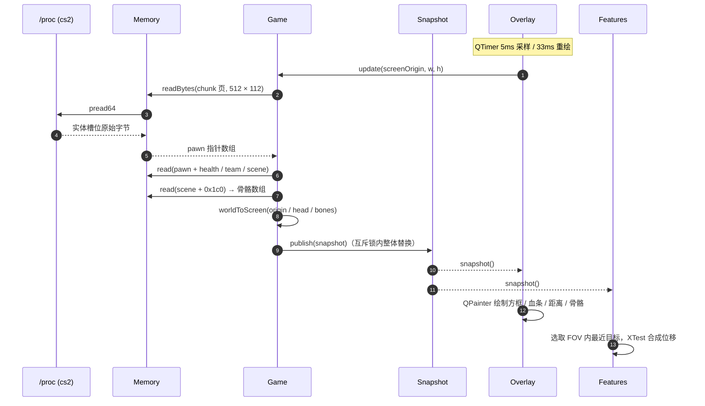
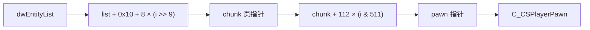
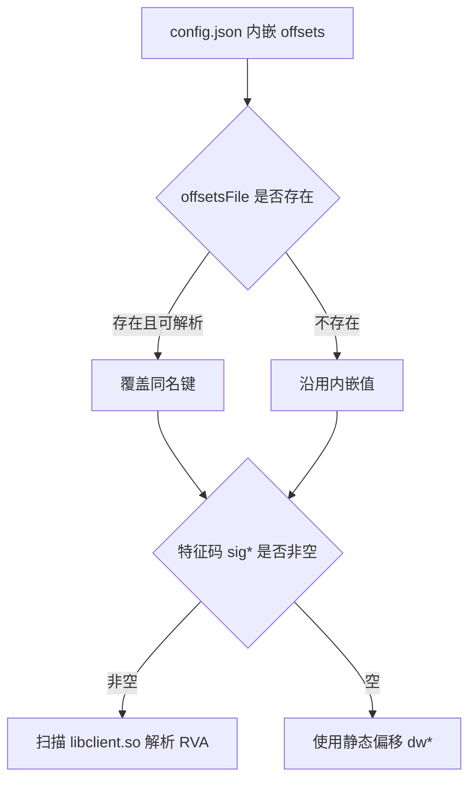

<div align="center">

# cs2-external

**Linux 原生 · CS2 外部只读辅助 · ESP / 自瞄 / 扳机**

一份可审计、可维护的工程化实现：不注入、不附加调试器、不写游戏内存，全部数据来自 `/proc`，全部输入走 XTest。

[](https://www.kernel.org/)
[](https://isocpp.org/)
[](https://www.qt.io/)
[](https://cmake.org/)
[](https://www.x.org/)
[](https://github.com/PFLcoolme/cs2-external/stargazers)
[](https://github.com/PFLcoolme/cs2-external/commits/main)

</div>

---

## 目录

| 章节 | 内容 |
|---|---|
| [1. 项目概览](#1-项目概览) | 定位、能力边界、非目标 |
| [2. 架构总览](#2-架构总览) | 分层图、模块职责 |
| [3. 数据流](#3-数据流) | 时序、实体分块模型 |
| [4. 技术栈](#4-技术栈) | 语言、框架、系统库 |
| [5. 环境要求](#5-环境要求) | 编译器、依赖、权限 |
| [6. 快速开始](#6-快速开始) | 构建、运行、验证 |
| [7. 配置说明](#7-配置说明) | 字段表、优先级、热更新 |
| [8. 偏移维护](#8-偏移维护) | 生成器、实测样例、骨骼布局 |
| [9. 关键实现](#9-关键实现) | 投影、叠加层、输入合成 |
| [10. 性能基线](#10-性能基线) | 实测数据与瓶颈 |
| [11. 故障排查](#11-故障排查) | 现象 → 根因 → 处置 |
| [12. 项目结构](#12-项目结构) | 目录树 |
| [13. 开发流程](#13-开发流程) | 规划文档、阶段日志、提交规范 |
| [14. 合规边界](#14-合规边界) | 只读承诺、使用限制 |
| [15. 路线图](#15-路线图) | 后续计划 |
| [16. 许可证](#16-许可证) | 授权状态 |

---

## 1. 项目概览

`cs2-external` 是一个运行在 Linux 桌面上的 CS2 **外部**辅助程序。它通过读取 `/proc/<pid>/mem` 获取游戏状态，用 Qt6 无边框透明窗口把信息叠加在画面上，并通过 XTest 合成鼠标输入。

**核心能力**

| 能力 | 说明 | 状态 |
|---|---|---|
| 方框透视 | 按玩家包围盒绘制矩形，颜色区分敌我 | ✅ 可用 |
| 血条 | 目标左侧竖向血条，颜色随血量渐变 | ✅ 可用 |
| 距离 | 目标脚下显示米数（units × 0.01905） | ✅ 可用 |
| 骨骼连线 | 头 → 颈 → 胸 → 骨盆，白色连线 | ✅ 可用（版本相关） |
| 自瞄 | FOV 内最近目标，平滑位移到头部 | ✅ 可用（`key=0` 为无条件） |
| 扳机 | 准星指向敌人时合成左键点击 | ✅ 可用 |
| 控制面板 | 实时开关与参数，写回 JSON | ✅ 可用 |
| 可见性双色 | 基于 `m_bSpotted` 降低不可见目标透明度 | ⚠️ 版本相关（当前恒 0） |

**明确非目标**

- 不注入 DLL / SO，不 hook 任何游戏函数。
- 不 `ptrace` 附加、不改写游戏内存。
- 不做反作弊对抗、不保证线上服务器可用。

---

## 2. 架构总览

<div align="center">
  
</div>

**模块职责**

| 层 | 目录 | 职责 | 关键约束 |
|---|---|---|---|
| 数据源 | —— | `/proc/<pid>/{comm,maps,mem}` | 只读 `O_RDONLY`，同用户可读 |
| 核心层 | `src/core` | 进程定位、内存读取、数学、偏移、配置 | 无游戏语义，可单测 |
| 游戏层 | `src/game` | 实体遍历、骨骼、投影、快照发布 | 只产出 `Snapshot`，不接触 UI |
| 渲染层 | `src/render` | Qt6 透明叠加层、绘制 | 只消费快照，禁止阻塞采样 |
| 输入层 | `src/features` | 自瞄、扳机、XTest 合成 | 独立线程，读快照不读游戏 |
| 界面层 | `src/ui` | 控制面板、配置写回 | 配置整体替换，无锁跨线程 |

> 依赖方向严格单向：`ui / render / features` → `game` → `core`。反向依赖视为缺陷。

---

## 3. 数据流



**实体分块模型**

CS2 的实体列表不是连续数组，而是「页表 + 槽位」结构：



- 每页 512 个槽位（`i >> 9` 定位页，`i & 511` 定位槽）。
- 槽位步长 **112（0x70）**，本机实测；`0x78` 在本版本命中 0 个健康实体。
- 采样时整页一次 `pread`（512 × 112 = 57 344 字节），失败才回退逐槽读取。

---

## 4. 技术栈

| 类别 | 选型 | 说明 |
|---|---|---|
| 语言 | C++20 | 使用 `std::atomic<std::shared_ptr<T>>` 做无锁配置交换 |
| 编译器 | GCC 13+ / Clang 16+ | CI 实测 GCC 16.2.1 |
| GUI | Qt6 Widgets（X11） | 叠加层与控制面板共用一套事件循环 |
| 构建 | CMake ≥ 3.21 + Ninja（可选） | `AUTOMOC`，`-Wall -Wextra -Wpedantic` |
| 系统库 | libX11 / libXext / libXtst | XShape 输入穿透、XTest 输入合成 |
| JSON | Qt `QJsonDocument` | 零第三方依赖 |
| 偏移工具 | Python 3（`tools/cs2_linux_offsets.py`） | 仅读 `/proc`，生成 `config/offsets.json` |

---

## 5. 环境要求

| 项 | 最低要求 | 说明 |
|---|---|---|
| 发行版 | 任意 glibc 桌面 Linux | X11 会话；Wayland 需 XWayland 且叠加层可能受限 |
| 内核 | 3.2+ | 需 `/proc/<pid>/mem` 与 `pread64` |
| 权限 | 与游戏同用户 | Yama 拦截时需 `kernel.yama.ptrace_scope=0` 或 `sudo` |
| 合成器 | picom / kwin 等 | 建议 `unredir-if-possible = false` 保持合成 |
| 显卡驱动 | 任意 | 仅影响游戏全屏模式，不影响读取 |

```bash
# 依赖安装（Debian / Ubuntu 系）
sudo apt install build-essential cmake ninja-build \
                 qt6-base-dev libx11-dev libxext-dev libxtst-dev
```

---

## 6. 快速开始

### 6.1 构建

```bash
cmake -S . -B build -DCMAKE_BUILD_TYPE=Release
cmake --build build -j"$(nproc)"
```

产物：`build/cs2_lite`；首次构建会把 `config/default.json` 复制为 `build/config.json`。

### 6.2 运行

```bash
./build/cs2_lite
```

启动后：

1. 控制面板出现，状态栏显示「已连接 pid=…」或「未找到进程: cs2」。
2. 游戏切到**无边框窗口 / 全屏窗口**（独占全屏无法叠加）。
3. 默认已开启方框、血条、距离；骨骼与自瞄可在面板中开关。

### 6.3 诊断模式

```bash
WV_DEBUG=1 ./build/cs2_lite 2>&1 | grep '\[tick\]'
# [tick] 1920x1080 valid=1 players=15 drawn=15
```

`valid` = 快照有效；`players` = 采集数；`drawn` = 实际绘制数，两者长期不一致说明被过滤或投影失败。

---

## 7. 配置说明

运行时配置为 **可执行文件同目录的 `config.json`**（即 `build/config.json`），首次启动由 `config/default.json` 复制生成。

### 7.1 配置优先级



### 7.2 `offsets` 字段

| 字段 | 含义 | 本机样例 |
|---|---|---|
| `dwEntityList` / `dwLocalPlayerPawn` / `dwViewMatrix` | 模块内静态偏移 | `0x4B9A750` / `0x49454B8` / `0x494CB00` |
| `entityListChunkBase` | 实体列表页表基偏移 | `16` |
| `entityChunkPtrStride` | 页指针步长 | `8` |
| `entityChunkShift` / `entityChunkMask` | 页索引移位 / 掩码 | `9` / `511` |
| `entityChunkStride` | 槽位步长 | `112` |
| `m_iHealth` / `m_iTeamNum` / `m_lifeState` | 生命 / 阵营 / 存活状态 | `1212` / `1367` / `1220`（uint8） |
| `m_pGameSceneNode` / `m_vecAbsOrigin` | 场景节点 / 世界坐标 | `1184` / `200` |
| `m_modelState` | 骨骼数组指针相对 scene 的偏移 | `448`（`0x1C0`） |
| `m_boneArray` | 骨骼数组二级偏移 | `0` |
| `boneStride` / `bonePosX/Y/Z` | 骨骼步长 / 坐标分量 | `32` / `0` / `4` / `8` |
| `boneHead/Neck/Chest/Pelvis` | 连线骨骼索引 | `6` / `5` / `4` / `0` |
| `m_bSpotted` | 可见性（1 字节 bool） | `11552` |

### 7.3 `esp` / `aim` / `trigger`

| 分组 | 字段 | 默认 | 说明 |
|---|---|---|---|
| `esp` | `enabled` / `box` / `health` / `distance` / `skeleton` | `true` | 绘制开关 |
| `esp` | `teamCheck` | `false` | 过滤队友 |
| `esp` | `visibilityCheck` | `false` | 不可见目标降低不透明度（依赖 `m_bSpotted`） |
| `esp` | `maxDistance` | `0` | 0 = 不限 |
| `aim` | `enabled` | `true` | 自瞄总开关 |
| `aim` | `key` | `0` | `0` = 无条件；`1/2/3` = 左/中/右键 |
| `aim` | `fovPixels` / `smooth` / `sensitivityFactor` | `220` / `5` / `0.45` | 范围、平滑步数、灵敏度 |
| `trigger` | `enabled` / `key` | `false` / `0` | 扳机开关与触发键 |
| `trigger` | `delayMs` / `cooldownMs` | `30` / `120` | 按住时长 / 冷却 |

> 面板点击「应用并保存」后整体替换 `AppState::config`（`atomic<shared_ptr>`），渲染与输入线程下一 tick 自动生效，无需重启。

---

## 8. 偏移维护

游戏每次更新都要重新取偏移，这是外部实现的固有成本。

### 8.1 生成器

```bash
# 游戏运行中执行，仅读 /proc
python3 tools/cs2_linux_offsets.py
# → config/offsets.json
```

生成器做三件事：

1. 解析 `/proc/<pid>/maps` 取 `libclient.so` 基址与可执行段范围。
2. 用特征码（`??` 通配、`${}` RIP 相对）定位 `dwEntityList` / `dwLocalPlayerPawn` / `dwViewMatrix`。
3. 通过 `libschemasystem.so` 的 `SchemaSystem_001` 遍历 netfield，取字段偏移。

### 8.2 本机实测样例（`ClientVersion 2000942` / `2026-11-04`）

| 键 | 值 | 取证 |
|---|---|---|
| `dwEntityList` | `0x4B9A750` | 唯一特征码命中，读出堆指针 |
| `dwViewMatrix` | `0x494CB00` | 64 字节 float 序列合理且逐帧变化 |
| `m_lifeState` | `1220` | 必须按 **uint8** 读；按 int 读得 256 |
| `entityChunkStride` | `112` | `0x70` 命中 2 个健康实体，`0x78` 命中 0 |
| `m_modelState` | `448` | `scene + 0x1C0` 即骨骼数组指针 |
| 骨骼布局 | `stride 0x20`，坐标 `+0/+4/+8` | `bone[0] ≈ m_vecAbsOrigin`，`bone[6].z` 高出约 54~60 |

### 8.3 骨骼取证方法

```text
对每个存活玩家的 CGameSceneNode：
  arr = read_u64(scene + 0x1C0)
  bone0 = read_vec3(arr + 0x20 * 0)
  bone6 = read_vec3(arr + 0x20 * 6)
判定：|bone0.z - origin.z| < 8 且 20 < (bone6.z - origin.z) < 100
实测：16 个存活玩家 checked=16 ok=16
```

---

## 9. 关键实现

### 9.1 世界坐标 → 屏幕坐标

Source 2 的视图矩阵是 4×4 **行主序**，用行向量右乘：

```cpp
const float w = x * m[3] + y * m[7] + z * m[11] + m[15];
if (w < 0.01f) return false;              // 位于相机后方
screen.x = (x * m[0] + y * m[4] + z * m[8]  + m[12]) / w;
screen.y = (x * m[1] + y * m[5] + z * m[9]  + m[13]) / w;
```

### 9.2 叠加层

| 关注点 | 做法 |
|---|---|
| 无边框透明 | `FramelessWindowHint \| Tool \| WindowStaysOnTopHint \| X11BypassWindowManagerHint` + `WA_TranslucentBackground` |
| 输入穿透 | `XShapeCombineRectangles(ShapeInput, 空区域)` |
| 置顶竞争 | 游戏会持续抬升自身 → 每 6 tick（≈30ms）`XRaiseWindow` |
| 几何跟随 | 每 10 tick 探测一次 `XGetWindowAttributes` + `XTranslateCoordinates` |
| 绘制节流 | 采样 5ms，重绘 33ms（30fps），避免整屏半透明表面高频提交 |

### 9.3 输入合成

```cpp
// 自瞄：按屏幕像素偏移缩放后合成相对位移
const int moveX = std::lround(dx * sensitivityFactor / smooth);
XTestFakeRelativeMotionEvent(display, moveX, moveY, CurrentTime);

// 扳机：按住 delayMs 后释放，cooldownMs 内不再触发
XTestFakeButtonEvent(display, 1, True, CurrentTime);
```

按键判定走 `XQueryPointer` 的 `Button1Mask << (key - 1)`；`key <= 0` 时跳过判定，即无条件执行。

---

## 10. 性能基线

本机（1920×1080，单实例）实测：

| 指标 | 数值 | 条件 |
|---|---|---|
| 单次采样 tick | **≈0.8 ms** | 整页读取命中 |
| CPU 占用 | **≈33%** | 采样 5ms / 重绘 33ms / 置顶 30ms |
| 采集与绘制一致性 | `players=15 drawn=15` | 无过滤条件 |
| 内存占用（RSS） | ≈78 MB | Qt6 运行时为主 |

历史对照：优化前单个 tick >3000ms、CPU 100%，根因是「每个实体都解析一遍 `/proc/<pid>/maps`」；现改为模块基址缓存 + 整页读取。

---

## 11. 故障排查

| 现象 | 可能根因 | 处置 |
|---|---|---|
| 状态栏「未找到进程: cs2」 | 游戏未启动 / 进程名不同 | 确认 `pgrep -x cs2` |
| 状态栏提示权限不足 | Yama 拦截或跨用户 | `sudo sysctl kernel.yama.ptrace_scope=0`，或同用户启动 |
| 方框位置漂移 | 视图矩阵偏移过期 | 重跑偏移生成器 |
| 完全无绘制 | 叠加层被游戏压住 | 改用无边框窗口 / 全屏窗口；确认置顶频率 |
| 只有血条没有方框 | 目标太远、包围盒高度 <6px | 拉近距离或放宽过滤 |
| 骨骼连线错位 | 骨骼索引或布局与版本不符 | 用 8.3 的取证方法重测 |
| 画面卡顿 | 采样/重绘过密或实例重复 | 保证单实例；检查 `top` |
| 独占全屏看不到 | 直通扫描输出绕过合成器 | 改无边框全屏，或关闭 `unredir-if-possible` |

---

## 12. 项目结构

```text
cs2-external/
├── CMakeLists.txt              # 构建入口（C++20 / Qt6 / X11）
├── config/
│   ├── default.json            # 默认配置模板（POST_BUILD 复制到构建目录）
│   └── offsets.json            # 本机实测偏移（生成器产物）
├── docs/
│   ├── PLAN.md                 # 需求 / 技术栈 / 方案 / 风险
│   ├── PHASE_LOG.md            # 阶段开发日志（问题 → 解决 → 验证）
│   └── assets/
│       └── architecture.svg    # 分层架构图
├── src/
│   ├── Main.cpp                # 装配：Game / Menu / Overlay / Features
│   ├── core/
│   │   ├── Memory.{h,cpp}      # /proc 定位、pread 读取、模块基址
│   │   ├── Math.h              # Vec2 / Vec3 / Mat4 / worldToScreen
│   │   ├── Offsets.h           # 偏移结构体与就绪判定
│   │   ├── OffsetsImporter.*   # dumper 风格 offsets.json 导入
│   │   ├── Patterns.h          # 特征码集中表
│   │   └── Config.{h,cpp}      # JSON 读写与优先级
│   ├── game/
│   │   ├── Game.{h,cpp}        # 实体分块遍历 → Snapshot
│   ├── render/
│   │   └── Overlay.{h,cpp}     # Qt6 透明叠加层
│   ├── features/
│   │   └── Features.{h,cpp}    # 自瞄 / 扳机线程
│   └── ui/
│       └── Menu.{h,cpp}        # 控制面板
└── tools/
    └── cs2_linux_offsets.py    # Linux 偏移生成器（仅读 /proc）
```

---

## 13. 开发流程

项目按「先规划、再实现、后验证」的强制流程推进，所有阶段留痕：

1. **规划**：`docs/PLAN.md` 写明需求目标、技术栈、实现方案、依赖 API、风险与兼容范围。
2. **实现**：严格复用官方文档 / 成熟开源实现的调用方式，禁止臆造 API 与参数。
3. **验证**：每次改动必须构建通过，并在游戏运行时用公开数据核对（探针或截图）。
4. **归档**：阶段结束在 `docs/PHASE_LOG.md` 追加「开发步骤 / 问题与解决 / 变更记录 / 验证结果 / 遗留风险」。

**提交规范**

```text
<type>: <一句话说明>

type ∈ feat | fix | perf | refactor | docs | chore
示例：fix: 骨骼数组改为 scene+0x1C0 并同步配置
```

---

## 14. 合规边界

- 本仓库仅用于**本地单机研究**：进程读取全部为只读，不注入、不改写、不绕过反作弊。
- 线上对战使用可能导致封号，风险由使用者自行承担。
- 请勿用于商业分发、代练、盈利性服务。
- 仓库不包含游戏资源、不包含任何第三方闭源代码。

---

## 15. 路线图

| 状态 | 项目 |
|---|---|
| ✅ | 实体遍历 / 投影 / 骨骼 / 自瞄 / 扳机 |
| ✅ | 偏移生成器与 dumper 导入 |
| ✅ | 性能治理（采样与重绘解耦） |
| 🚧 | 骨骼全骨架连线（脊柱 + 四肢） |
| 🚧 | 可见性判定（射线 / BSP 替代 `m_bSpotted`） |
| 💡 | 配置热重载（文件监听） |
| 💡 | 单元测试（Math / Config / Importer） |
| 💡 | CI：构建 + clang-format + 静态分析 |

---

## 16. 许可证

仓库暂未添加 `LICENSE` 文件，默认保留所有权利（All rights reserved）。如需开源授权，请先补充许可证再对外分发。

---

<div align="center">

**构建即验证 · 数据即证据**

</div>
