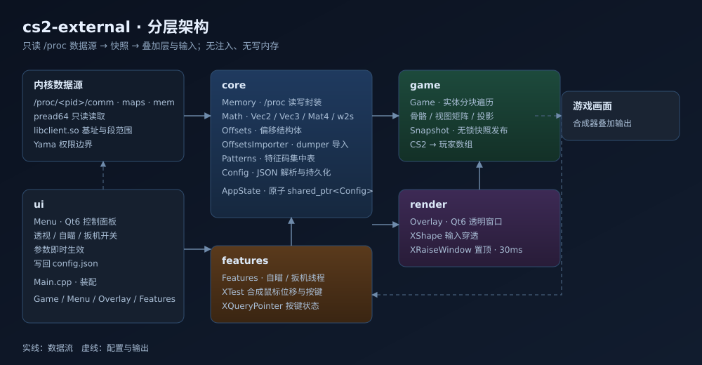

# CS2 外部辅助：当前技术方案与维护计划（Linux）

> 文档基线：2026-11-14，对应主分支 `v1.0` 实现。本文描述**当前代码如何工作以及后续如何维护**，不再逐阶段重复历史方案；历次决策、实机取证和失败路径见 [PHASE_LOG.md](PHASE_LOG.md)，使用说明见 [README.md](../README.md)。
>
> 证据口径：`代码已实现` 不等于 `对局效果已验证`；`pwrite64 成功` 不等于服务器认可；历史实测数值只适用于记录中的游戏版本。当前版本必须重新生成偏移并验证。

## 1. 目标与边界

### 1.1 当前能力

- ESP：方框、血量/护甲、距离、骨骼、伤害浮字、残影、雷达、屏外箭头、敌人列表、高度差、准星信息与战绩 HUD。
- 输入功能：自瞄、输入式后坐力补偿、子弹追踪、静默锁头、自动扳机。
- 直接内存功能：加速、子弹追踪内存锁、飞天、身体旋转、真无后坐力、弹着点控制，共六组，默认全部关闭。
- 工程能力：Qt6 控制面板、400 ms 防抖保存、配置与偏移热重载、上一配置回滚、启动自检、诊断日志、单元测试和 CI。

### 1.2 明确边界

- 不注入 DLL/SO，不 hook 游戏函数，不通过 `ptrace` 附加，不包含反作弊绕过。
- 仅面向 Linux X11；Wayland 只能尝试 XWayland，原生 Wayland 的窗口与输入能力不受支持。
- 独占全屏不保证叠加；推荐无边框窗口或全屏窗口。
- 线上使用有封号风险。仅用于本地单机或自建环境研究。
- 内存锁角、散布和速度等字段即使可写，也可能被客户端预测覆盖或不被服务器采用，必须用探针和对局证据分别判断。

## 2. 技术栈与依赖

| 类别 | 当前选型 | 用途 |
|---|---|---|
| 语言 | C++20 | `std::atomic<std::shared_ptr<Config>>`、线程与标准库容器 |
| 构建 | CMake ≥ 3.21，可选 Ninja | `AUTOMOC`，测试默认开启 |
| GUI | Qt6 Core / Gui / Widgets | 面板、透明叠加层、JSON |
| 窗口与输入 | X11、Xext/XShape、Xtst | 窗口定位、输入穿透、按键轮询、XTest 回退 |
| 内核接口 | `/proc/<pid>/mem`、`/dev/uinput` | 进程读写、常驻虚拟鼠标 |
| 脚本 | Python 3 标准库 | 偏移生成与只读/写入探针 |
| CI | GitHub Actions，`ubuntu-24.04` | Release 构建与 `ctest` |

编译器以支持 C++20 的 GCC/Clang 为准；README 中的 GCC 13+ / Clang 16+ 是使用基线，不是代码中的强制版本检查。

## 3. 当前架构与线程模型



| 模块 | 职责 | 不承担的职责 |
|---|---|---|
| `core/Memory` | 定位进程、打开 mem、模块映射、`pread64` / `pwrite64`、特征码扫描 | 不理解玩家与武器语义 |
| `core/Config` | 默认值、JSON 读写、保留未知字段、dumper 导入 | 不扫描进程 |
| `core/UInput` | 创建/销毁虚拟鼠标，发送相对位移和 Button1~3 | 不读取游戏状态 |
| `game/Game` | 偏移解析、实体采集、骨骼/投影、快照与诊断 | 不直接操作 UI |
| `render/Overlay` | 5 ms 采样调度、窗口跟随、约 30 Hz 绘制、命中统计 | 不合成输入 |
| `features/Features` | 1 ms 输入线程、热键、选靶、UInput/XTest | 不写游戏字段 |
| `features/MemoryEngine` | 2 ms 内存线程；锁角开启时 1 ms；恢复已缓存字段 | 不合成鼠标事件 |
| `ui/Menu` | 五页面板、自动保存、热重载、备份、自检与日志展示 | 不在工作线程操作控件 |
| `Main.cpp` | Xlib 线程初始化、启动刷新偏移、对象装配与退出回收 | 不实现功能逻辑 |

依赖方向保持 `ui / render / features → game → core`。配置通过原子 `shared_ptr` 整体替换；`Snapshot` 和状态字符串由 mutex 保护并整份复制，不宣称快照“无锁”。任何 Xlib 调用之前先执行 `XInitThreads()`，输入线程与内存线程各自持有 X Display 连接。

## 4. 进程、内存与偏移解析

### 4.1 附加与读写降级

1. 遍历 `/proc/*/comm` 定位 `cs2`。
2. 优先以 `O_RDWR | O_CLOEXEC` 打开 `/proc/<pid>/mem`，失败再尝试 `O_RDONLY | O_CLOEXEC`。
3. 用 `pread64` 读取；只有可写 fd 才允许 `pwrite64`，只读回退时内存引擎跳过功能写入。
4. 从 `maps` 计算 `libclient.so` 基址与范围，模块基址缓存，避免每个实体重复解析。
5. 权限受 Yama、用户和 capabilities 约束；同用户并不保证一定能读或写。

### 4.2 配置与偏移优先级

```text
C++ 默认值
  → 可执行文件旁 config.json 的 offsets 段
  → offsetsFile 指向的扁平或 cs2-dumper 分层 JSON（同名字段覆盖）
  → Game::resolveOffsets()
       dw* 非零：直接采用静态 RVA，不扫描特征码
       dw* 为零：优先 sig*；sig* 为空则使用 Patterns.h 内置特征码
```

`offsetsFile` 的相对路径按进程当前工作目录解析。CMake 会把 `config/offsets.json` 复制到可执行文件旁的 `config/`，因此从仓库根目录或 `build/` 启动通常都能解析。自定义发布目录必须保持该相对结构，或改成合适路径。

导入器支持数字、`0x` 字符串和 `{"value": N}`，并按类作用域选择同名字段。不要把外部文件的静态 RVA 与来自另一游戏版本的 schema 字段混用。

### 4.3 实体与骨骼

- 最多遍历 2048 个槽；页大小由 `entityChunkMask + 1` 得出，默认 512。
- 地址：`chunk = list + 0x10 + 8 * page`，`pawn = chunk + 112 * slot`。
- 每页尝试一次读取 `512 × 112 = 57344` 字节，失败时逐槽回退。
- 过滤死亡、非 2/3 队伍、空 scene 与非法投影；`m_lifeState` 按 `uint8` 读取。
- 骨骼指针为 `scene + m_modelState + m_boneArray` 处保存的地址；当前配置使用 `m_modelState=448`、步长 32、坐标 `+0/+4/+8`。
- 骨骼不可用时头部退化为原点上移 62 units；这只保证功能降级，不代表完整骨架可用。

## 5. 快照、叠加层与统计

### 5.1 数据流

```text
Overlay QTimer（5 ms）
  → Game::update(origin, width, height)
  → 模块全局 / 本地 pawn / scene / punchServices
  → 实体页批量读取、骨骼和世界到屏幕投影
  → mutex 内发布 Snapshot
       ├─ Overlay：HUD 与 ESP 绘制
       ├─ Features：目标选择与输入
       └─ MemoryEngine：目标选择、运行时基址与字段写入
```

- 窗口几何每 10 tick（约 50 ms）探测；每 6 tick（约 30 ms）抬升叠加窗口。
- 采样与窗口探测解耦：窗口不可映射时仍用名义分辨率采集，内存功能不依赖画面是否成功叠加。
- 重绘间隔 33 ms；XShape 空输入区域和 Qt 鼠标穿透共同避免挡住游戏输入。
- 世界坐标到米使用 `1 / 39.37`；矩阵按当前 `Math.h` 的行主序投影公式处理。
- 命中/伤害/击杀统计从血量差值推导，与“伤害浮字”显示开关解耦；F10 只清本次进程内计数，不读写游戏战绩。

## 6. 输入合成方案

### 6.1 后端顺序

1. `Features` 启动时创建常驻 `/dev/uinput` 虚拟鼠标，发送 `EV_REL`、`EV_KEY` 和 `SYN_REPORT`。
2. 设备不可用或单次发送失败时，回退 `XTestFakeRelativeMotionEvent` / `XTestFakeButtonEvent`。
3. UInput 仅映射左、中、右三个按钮；设备在进程存活期间保持，给 SDL 热插拔枚举留时间。
4. 物理鼠标状态由 `XQueryPointer` 读取；键盘 keysym 经 `XKeysymToKeycode` 后用 `XQueryKeymap` 检查，不抓取键盘。

XTest 在采用 SDL raw input 的 CS2 环境中可能被忽略，因此它是兼容回退，不再是首选路径。日志中的 `backend=uinput` 与 `uinput_ready=1` 才可证明首选后端已就绪。

### 6.2 功能与互斥

| 功能 | 当前逻辑 | 主要限制 |
|---|---|---|
| 自瞄 | FOV 内选靶，按平滑、灵敏度与屏幕误差移动；开镜键和开火键同时满足 | `lockTarget` 只锁定到死亡或离开 FOV；支持队伍/距离过滤 |
| 后坐力补偿 | 读取 punchServices 的角度，只补偿帧间增量，按强度缩放 | 与持续锁头可能互相拉扯；异常大增量丢弃 |
| 输入式子弹追踪 | 按住触发键，将准星移向目标头部；FOV=0 表示全屏 | 仍依赖客户端视角和服务器命中判定 |
| 静默锁头 | 贴头 → 点击 → 等待 `holdMs` → 归位 | 不是 CUserCmd 级 silent aim；等待期间输入线程阻塞 |
| 自动扳机 | 准星实体为有效敌人时点击，带按住与冷却时间 | 队伍过滤可配；不能据此推断真实遮挡关系 |

输入循环按“静默/追踪/自瞄/后坐力/扳机”的既有分支协调，避免同一轮多个功能重复移动或点击。Panic 停止所有输入合成，并同时阻止内存写入。

## 7. 直接内存引擎

### 7.1 公共前置条件与恢复

- 配置已显式开启、快照有效、本地 pawn 非空、mem fd 可写、所需偏移存在。
- 缺失项写入 `AppState::memoryMissing`，成功写入累计到 `memoryWrites`，面板和 `[mem]` 日志显示状态。
- 锁角、MoveType、旋转与 maxspeed 等需要恢复的字段先缓存原值；功能退出、Panic 或线程停止时尝试恢复。
- 恢复依赖进程与快照仍可用；游戏退出、权限消失或强制杀进程时不保证恢复成功。

### 7.2 六组功能

| 功能 | 写入路径 | 安全/效果边界 |
|---|---|---|
| 加速 | `m_flVelocityModifier`，并放大 movementServices 的 `m_flMaxspeed` | 倍率钳制 1~5；只证明字段可写不代表服务器接受速度 |
| 子弹追踪内存锁 | 写 eye/stashed shoot angles，清角速度和历史角；按配置保护或同步 `v_angle` | `bulletLockSyncView=false` 时画面可不动但服务器可能按真实朝向 miss；开启后相机随目标 |
| 飞天 | 按热键写 `m_vecVelocity.z` 与 `m_vecAbsVelocity.z`，可选 MoveType | `flyUpKey=0` 会常驻上升；只在偏移和指针链有效时工作 |
| 身体旋转 | scene 的 `m_angRotation`；关闭 `spinKeepView` 才写 `m_angAbsRotation` | absRotation 会带动渲染画面，默认不写 |
| 真无后坐力 | punchServices 的 base/velocity/unpredictable，加 camera view punch，可选有界 cache | cache 仅在 `aimPunchCacheBytes>0` 时清，且长度钳制到 256 |
| 弹着点控制 | 安全模式清 flinch 与武器 shake time；非安全模式额外清预测/散布字段 | 非安全模式可能造成客户端与服务器判定分叉，不代表真正取消服务器散布 |

武器侧字段通过 `pawn → weaponServices → active weapon handle → entity list` 解析；任一级失败即跳过。`m_flSpreadVData` 目前只有字段偏移，没有完整 VData 指针链，不能据此宣称静态基础散布已控制。

### 7.3 证据分级

1. **写入证据**：`writable=1`、写入计数增加、读回值改变。
2. **保持证据**：哨兵探针为 HELD/PARTIAL，说明客户端是否快速覆盖。
3. **效果证据**：离线对局录屏、日志和伤害结果交叉验证。
4. **服务器证据**：当前外部实现不能直接证明；禁止由前三级推断“服务器一定认可”。

## 8. 配置、面板与日志

### 8.1 配置生命周期

- 路径固定为 `<applicationDirPath>/config.json`，不是 shell 的当前目录。
- 启动时若文件不存在，`Main.cpp` 用 C++ 内置默认值创建；CMake 源码构建则通常已提前复制 `config/default.json`。
- 面板改动 400 ms 防抖自动保存；底部“应用并保存”可立即保存。
- 保存前若三个全局 RVA 任一为零则拒绝落盘，防止一份空配置让全功能失效。
- 每次保存先把现有文件复制为 `config.json.bak`；“恢复上一次”会校验 JSON，再保存，因此再次恢复可切回。
- `Config::save` 先读回原 JSON，保留当前二进制不认识的根字段和 offsets 字段；但写文件本身不是事务性 `QSaveFile`，异常断电不在保证范围内。
- UI 与两个工作线程通过原子 `shared_ptr<Config>` 交换完整配置，读者不修改共享对象。

### 8.2 热重载

- UI 每 400 ms 比较 `config.json` 和可执行文件旁 `config/offsets.json` 的 mtime。
- 外部改动会重新 `Config::load` 并回填控件；回填期间禁止防抖保存，避免读回又立刻写回。
- 只有偏移实际变化才 `Game::reloadOffsets` 并重新解析模块/特征码，普通开关变化不做昂贵扫描。
- 自动启动刷新只负责更新 offsets 文件，随后由正常加载/热重载路径采用；生成失败不阻止启动。

### 8.3 日志与自检

- 共享日志首选 `/tmp/wv_lite.log`；不可写时统一回退 `/tmp/wv_lite_<uid>.log`，避免面板与写入方路径分叉。
- 输入诊断超过 2 MB 截断；`WV_DEBUG=1` 增加终端输出，不是开启磁盘日志的必要条件。
- 面板日志页按需读取末尾内容；自检约每 2 秒刷新，列出模块、9 个关键偏移和两个运行时指针。
- `[mem]` 区分只读回退、无效快照、缺失偏移、目标选择和写入计数；它是排障证据，不是服务器结果证明。

## 9. 工具链

### 9.1 `tools/cs2_linux_offsets.py`

```bash
python3 tools/cs2_linux_offsets.py        # 生成、回读校验并写 config/offsets.json
python3 tools/cs2_linux_offsets.py scan   # 只打印原始特征码命中
```

- 只以 `O_RDONLY` 打开游戏，不写目标进程；需要游戏运行，完整生成还要求已进入对局以定位本地 pawn。
- 扫描 Linux ELF 的 `libclient.so`，通过 RIP 相对指令定位全局；经 `libschemasystem.so` 的 `SchemaSystem_001` 遍历字段。
- 校验实体列表、controller/pawn 回链、视图矩阵变化、生命/护甲/队伍和场景原点。
- 可选字段未命中写 0，对应功能跳过；生成结果不是跨版本常量，不能只看 JSON 非零就认定运行时有效。
- 客户端启动时从可执行文件目录向上最多五层寻找该工具，等待启动 3 秒、执行最多 15 秒；失败沿用旧文件。
- 设置 `WV_SKIP_OFFSETS=1` 可跳过启动刷新；源码/工具不随二进制自动出现，精简发布包只能沿用随包偏移。

### 9.2 `tools/cs2_probe_features.py`

```bash
# 先正常退出 cs2_lite，避免它和探针同时写字段；默认采样 96 次
python3 tools/cs2_probe_features.py
python3 tools/cs2_probe_features.py 192
```

这是**写入型**哨兵工具：修改 float → 1 ms 间隔读回 → 恢复原值。HELD ≥ 0.9、PARTIAL ≥ 0.2，其余为 OVERWRITTEN；地址无效、不可读、不可写也会单独显示。它需要 `O_RDWR`，仅用于离线环境。HELD 只证明值能保持，不证明玩法效果或服务器认可。

### 9.3 `tools/cs2_probe_accuracy.py`

```bash
python3 tools/cs2_probe_accuracy.py      # 默认 3 次
python3 tools/cs2_probe_accuracy.py 10
```

只读显示 pawn、camera 与当前武器上的动态散布/抖动字段，采样间隔 200 ms。未持枪、观战或死亡时武器链为空属预期。字段为 0 只能作为引擎压零的观察证据，仍需弹道与伤害结果验证。

三个脚本均无 argparse 帮助页，不要把 `--help` 当无副作用命令；它会按普通参数或正常执行路径尝试连接游戏。

## 10. 构建、测试与 CI

```bash
cmake -S . -B build -G Ninja -DCMAKE_BUILD_TYPE=Release
cmake --build build -j"$(nproc)"
ctest --test-dir build --output-on-failure
python3 -m py_compile tools/cs2_linux_offsets.py \
  tools/cs2_probe_features.py tools/cs2_probe_accuracy.py
```

- 默认目标：`cs2_lite` 与 `cs2_tests`；`-DCS2_LITE_BUILD_TESTS=OFF` 可关闭测试。
- 测试覆盖 Math 的投影/朝向/屏外方向，以及 Config 默认值、六组内存默认值和 JSON 往返。
- 主程序启用 `-Wall -Wextra -Wpedantic`；目标链接 Qt6、X11、Xext、Xtst。
- CI 在 main 推送、PR、v* 标签和手动触发时执行相同 Release 构建与测试。
- 单元测试不连接 CS2，不验证 X11 合成器、UInput 枚举、当前偏移或服务器行为；这些必须分别做桌面和对局验收。

## 11. 游戏更新后的维护流程

1. **更新并取证**：记录 ClientVersion、日期、进程与模块信息，保留旧配置备份。
2. **生成偏移**：进入离线对局，运行生成器；三个全局 RVA、实体步长、骨骼和新增内存字段分别检查。
3. **审查差异**：比较新旧 `offsets.json`，识别 0 值、异常跳变和 class 作用域变化；不要批量沿用旧值。
4. **先只读验收**：关闭全部输入与内存功能，确认玩家、队伍、生命、护甲、投影和骨骼正确。
5. **再验输入**：确认 `backend=uinput` / `uinput_ready=1`，逐项检查热键、移动、点击、Panic 与目标过滤。
6. **最后验内存**：先退出主程序跑哨兵，再启动主程序逐项开启，记录读回、覆盖、恢复和 `[mem]`。
7. **效果与副作用**：录屏检查弹道、伤害、相机、速度、视角及退出恢复；不把客户端反馈当服务器证据。
8. **回归与归档**：构建、CTest、Python 语法检查、X11 冒烟；更新 README/PLAN 的当前值，将详细取证追加到 PHASE_LOG。

## 12. 验收清单

| 层级 | 必须检查 | 当前自动化覆盖 |
|---|---|---|
| 文档/配置 | JSON 合法、链接可达、默认键与 Config 对齐、示例数值与 offsets 文件一致 | 可在仓库脚本/本地检查 |
| 编译/单元 | Release 编译无错误，CTest 通过 | CI 每次 main / PR 执行 |
| 桌面 | X11 窗口跟随、透明、穿透、面板搜索/录制/保存、Xvfb 存活 | 无 CI，需要桌面或 Xvfb |
| 进程只读 | mem 打开、模块基址、实体、矩阵、骨骼、只读降级 | 需要运行中的游戏 |
| 输入 | UInput 就绪、XTest 回退、鼠标/键盘热键、Panic | 需要游戏与真实输入 |
| 内存写入 | 前置条件、原值缓存、关闭恢复、武器链、缺失偏移跳过 | 需要离线对局 |
| 玩法结果 | 锁角命中、散布、加速/飞天、旋转观感、服务器伤害 | 无自动化，不可由编译推断 |

## 13. 后续维护计划

### 13.1 优先维护

- 游戏更新后先修复偏移与回读校验，再处理功能效果；历史数值不得直接作为当前基线。
- 配置新增字段时同步 `Config.h` 默认值、`Config.cpp` 读写、`config/default.json`、UI apply/sync、测试和文档。
- 新内存字段必须有缺失偏移跳过、地址范围保护、关闭恢复和诊断，不写入未经确认的指针链。
- 任何声称“真实命中”“无后坐力”“速度生效”的提交，必须附与结论层级相符的离线对局证据。
- 保持 Qt 控件只由 GUI 线程访问；新增工作线程共享数据须明确原子或 mutex 边界。

### 13.2 后续可选项（未实现，不纳入当前承诺）

- 把 offsets 与探针的公共进程读取、schema 和指针链代码抽成共享 Python 模块，减少漂移。
- 为 offsets 导入、X11 keysym、输入状态机和内存恢复增加无游戏依赖的可测试边界。
- 将合法 JSON、文档示例、SVG/XML 和 Markdown 本地链接检查纳入 CI。
- 若要支持原生 Wayland，应单独立项评估门户、全局输入和叠加协议；不能用现有 X11 路径宣称兼容。

## 14. 许可与变更原则

- 本项目采用 **GPL-3.0-only**，完整正文见仓库根目录 [LICENSE](../LICENSE)；没有附加 “or any later version” 授权。
- README、PLAN、架构图和源码注释用于解释现状；PHASE_LOG 保留历史，不回写历史阶段使其看似当时已经验证。
- 文档修订不得夹带运行逻辑改动。行为变化应单独提交、单独测试，并明确新增风险。